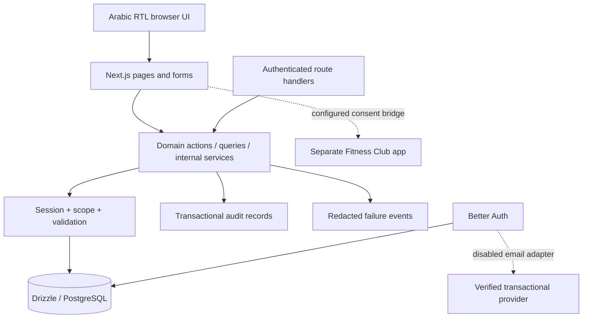

# Architecture

## Deployed application shape

A modular monolith: Next.js App Router, server components/client forms, server actions and route handlers, Drizzle, and network PostgreSQL. Vercel is the current application host. The production database provider/backup controls have not been directly verified for this documentation; do not infer a restore policy from earlier notes naming Neon.

[Rendered architecture diagram](Architecture.svg) is generated from [editable Graphviz source](Architecture.dot).

## Boundaries

Identity, catalog, membership, content, learning, personal learning, institutions, portal commerce/services, academic teams, volunteering, certificates and social content are local modules. Shared transactions/joins are intentional. This is not a microservice deployment or a claim of separate domain databases.

Client controls cannot grant a role. Server entry points derive the viewer and validate ownership, status, active parents and section rights. Queries must not return protected bodies merely because public metadata is visible. Mutation success must reflect a committed result rather than a filled form.

## Storage

Network PostgreSQL on deployment; local PGlite is a single-writer development/test fallback only. Vercel rejects a missing DATABASE_URL. Better Auth and application tables share the configured database. Files/media currently use existing database-backed paths, with restaurant logos/covers still embedded as data URLs in institution JSON. A separate restaurant-media migration was tested locally but intentionally not released pending backup/restore verification.

## Release and failure behavior

The current Vercel build command still builds, migrates, seeds and runs configured demo provisioning. PostgreSQL advisory locks serialize migration application, but do not prove backup coverage or isolate preview databases. A dedicated migration/release job remains operational work. Failure logs contain a fixed scope, incident identifier and timestamp, not payloads or raw exceptions. External alert delivery is not configured.

## Architecture decisions not made

Queue, cache service, object-storage provider, live payment gateway, AI provider/model, production capacity and service-level objectives are not yet decided. Do not add them to diagrams as deployed infrastructure.
