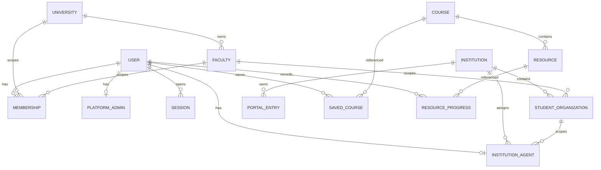

# Focused entity relationship view

This view explains core scope. It does not enumerate every portal table or composite constraint. Use the [table inventory](../04-Technical-Docs/Database-Tables.md), Drizzle definitions and migrations for the full model.

Membership and agent status are separate. Platform rights do not derive from an ordinary membership role string. Coordinator is represented through existing agent/organization capabilities, not a new identity table. Section permissions are stored with agent assignment. Restaurant profile JSON and legacy entry fields coexist intentionally until a reviewed migration is released.
