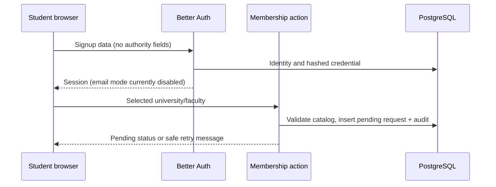
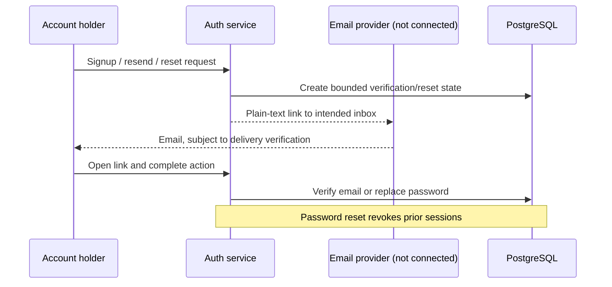

# Data flows and sequence views

## Signup and membership, current mode

Identity creation and the subsequent membership request are separate. A failed membership action must not imply the identity was rolled back.

## Scoped read/write

Browser -> server entry point -> session resolution -> active membership/agent and parent scope -> validated query/transaction -> safe result. Protected file download routes repeat authorization and use private/no-store where specified. CSV export is an authorized disclosure, not a public static file.

## Future-enabled email flow

Only accounts created on/after a fixed activation timestamp require verification. Neither verification nor password reset approves university/agent access. The feature remains disabled.

## Intended balance flow, not implemented

Student -> external gateway top-up -> validated provider confirmation/reconciliation -> Student Center balance -> eligible in-platform service payment. Owner business rule: 100 paid credits 98. Provider selection, webhook contract, ledger/refunds and rounding remain undecided. No arrow in this planned flow indicates an existing live integration.
