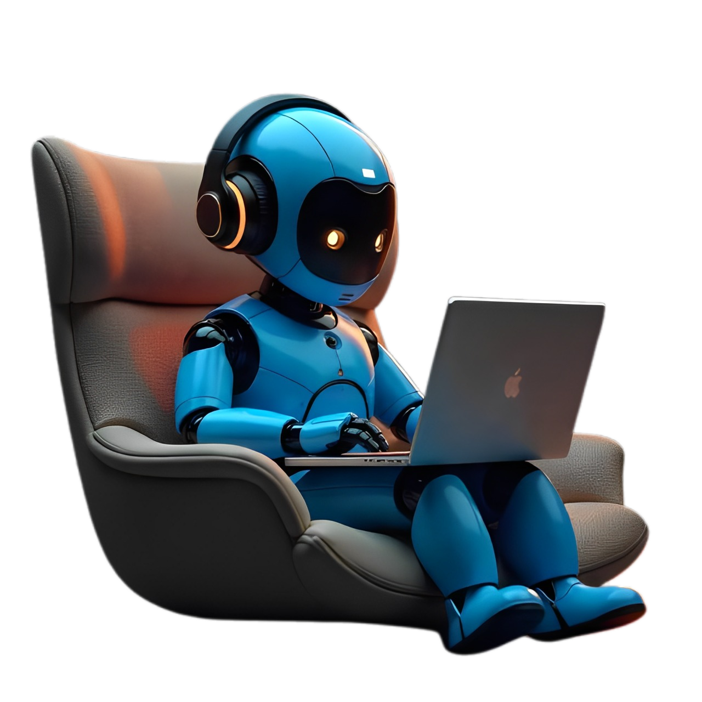

# Gumball Mascot

Gumball is Student Hub Egypt's mascot and the name selected for the future AI helper. These files are design exports, not an implemented AI feature. They are stored here for download and do not replace the website's current assets.

| File                       | Format and fidelity                                                                                                                                                                                                                                        |
| -------------------------- | ---------------------------------------------------------------------------------------------------------------------------------------------------------------------------------------------------------------------------------------------------------- |
| [Gumball.png](Gumball.png) | 1280 x 1280 transparent raster cutout. Automatic background removal can leave a faint light fringe on dark backgrounds.                                                                                                                                    |
| [Gumball.psd](Gumball.psd) | Same raster cutout, one flat layer. Robot, chair and laptop are not separate editable layers.                                                                                                                                                              |
| [Gumball.ai](Gumball.ai)   | PDF-based Illustrator-compatible automatic vector trace. Approximate and stylized: gradients, eye glow and texture are simplified into flat regions. White background, not transparent. Not a faithful hand-redrawn vector or original Illustrator source. |

Source used for the exports: the repository's `public/design/blue-robot-hero.jpg`, 1280 x 1280, with a light background. The website also has a smaller mirrored transparent asset, which is not the source of these exports. These files are preserved as supplied, without modifying the export fidelity.

A true separated-layer PSD or faithful vector would require additional design work. No such editability is claimed here. Asset ownership/licensing is not established by a format conversion; confirm rights before commercial redistribution.
